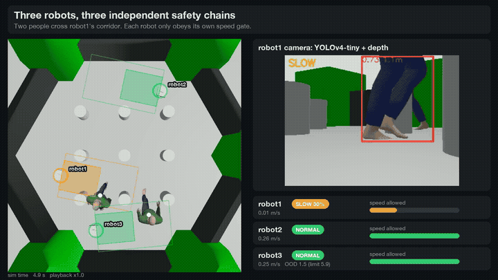
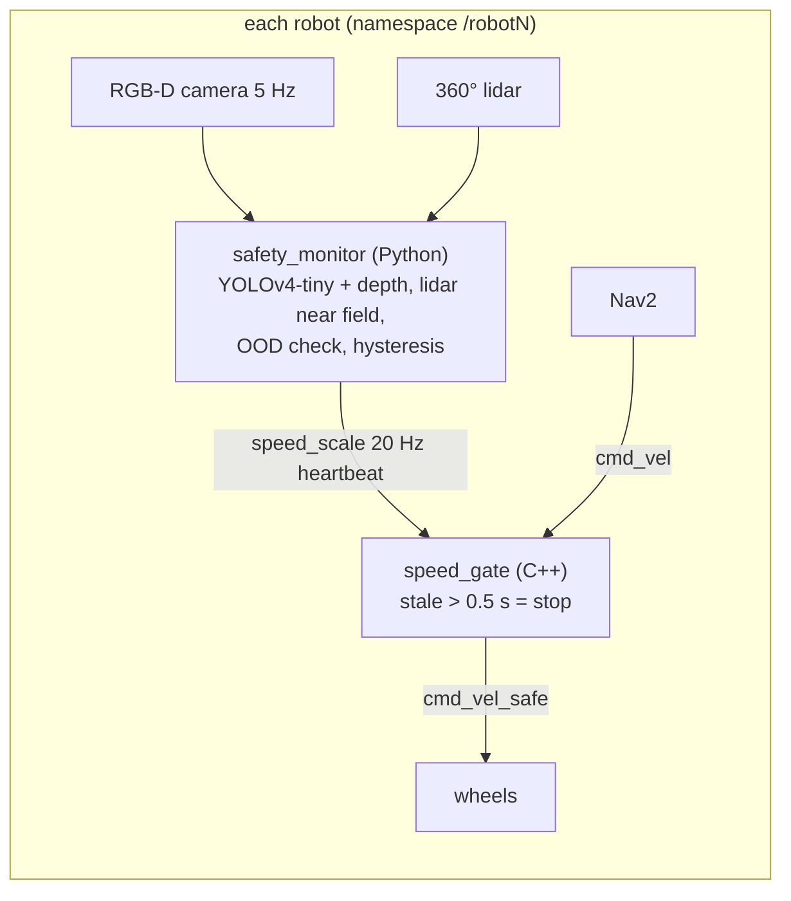

# ROS 2 Robot Fleet with a Safety Layer

Three simulated mobile robots run Nav2 missions while people walk through their lanes. Each robot has its own safety chain:
- **Camera:** spots people and slows the robot early.
- **360° lidar:** stops it for anything unknown in its protective zone.
- **Degraded-image check:** slows it down when the camera image can't be trusted (fog, darkness, dirt on the lens).
- **Fail-safe gate (C++):** stops the robot if the safety monitor goes quiet.

Every number below is measured against simulator ground truth.



**[Full 2-minute demo video (MP4)](docs/media/demo.mp4)**. It shows people stops, a crashed safety monitor on robot2, and a fogged camera on robot3. It was rendered from a recorded run (`make demo && make render-demo`), and the captions come from the logged safety states.

> A learning demonstrator, **not** a certified safety function. Real deployments need certified safety laser scanners and a safety PLC (ISO 13849 / IEC 61508).

## Why it matters

Mobile robots are moving into Italian warehouses, airports and hospitals. The EU Machinery Regulation 2023/1230 applies from 20 January 2027 and adds requirements for safety functions that use machine learning. Integrators need engineers who can combine ROS 2 navigation, perception and conservative safety logic, and who can measure how well the result works.

**Relevant employers in Italy:** Comau, Alba Robot, Cyberwave, Oversonic, Teoresi, Fogliani

## How it works



| Situation | Response |
|---|---|
| Person within 2 m ahead (camera) | SLOW to 30% |
| Person within 1 m ahead (camera), or any lidar return in the zone that is not on the map and not another fleet robot | STOP |
| Camera image out-of-distribution (fog, dark, noise, smudge) | SLOW |
| No camera frame or no evaluated scan for 0.5 s | STOP |
| Safety monitor crashed, so no heartbeat for 0.5 s | the C++ gate stops that robot only |

The wheels listen only to `cmd_vel_safe`, and only the gate publishes it. This closed a real bypass: Nav2's `docking_server` was publishing straight to the robot. Leaving STOP needs the zone to be clear for 1 s, so flickering detections can't make the robot lurch. More detail is in [docs/ARCHITECTURE.md](docs/ARCHITECTURE.md).

## Results

**Safety layer** (crossing scenario: people cross robot1's corridor at many distances and phases)

| Metric | Value |
|---|---|
| Stop-zone entries missed, camera alone | **4 of 13**. A 60° camera sees the full 0.8 m-wide zone only beyond ~0.76 m. |
| Stop-zone entries missed, camera + lidar near field | **0 of 16** |
| Stop latency after a person enters the zone (median, n=3) | **command 0.13 s, robot halted 0.46 s** |
| False stops | **0 in 24.5 robot-minutes** without people, 1 in 3 robot-minutes with people |
| Camera recall for a person ahead, by distance | 0.5–1 m 7/56 · 1–1.5 m 24/117 · 1.5–2 m 12/14 · 2–2.5 m 36/59 |
| Fault injection: robot2's monitor killed (SIGKILL) mid-mission, perception on | gate output zero after **0.51 s**, robot halted after **0.80 s**, robot1 and robot3 drove 1.24 m each during the 5 s outage, robot2 resumed 2.9 s after restart |

**Degraded-camera (OOD) detection** (210 clean frames, 6 synthetic corruptions)

| Scorer | Mean AUROC |
|---|---|
| Image statistics + Mahalanobis (deployed) | **0.93** |
| MobileNetV2 features + Mahalanobis | 0.80 |
| ImageNet energy score | 0.45, worse than chance |

With the deployed threshold, no clean test frames from the training routes were flagged. Fog, darkness and noise were caught 100% of the time, a smudge 60%, and blur and overexposure only 12%. When fog was injected live, the robot drove the whole route in SLOW (362 s instead of 112 s) and still reached 6 of 6 goals. **On a lane the model had never seen (robot3's south lane in the demo, close to the walls), 12–16% of clean frames were flagged**, against 80% during fog. The calibration doesn't transfer to new viewpoints, so a real deployment would recalibrate per site.

**Fleet** (week 2): 14 of 14 goals in one run (makespan 58.8 s sim) and 13 of 14 in a second run. The closest robot-to-robot approach was 0.42 m.

All of this comes from minutes of simulation, so treat the numbers as engineering measurements, not safety claims. The full notes, including what went wrong, are in [docs/ROADMAP.md](docs/ROADMAP.md).

## Engineering decisions worth discussing

- **I measured the camera's blind spot instead of assuming coverage.** Scoring against ground truth showed that about half the protective field is invisible to a forward camera. That is why the lidar handles the near field and the camera's job is to recognise a person at 2–3 m and slow early, the same split used in industrial mobile-robot safety.
- **The textbook OOD score failed.** Energy scores from an ImageNet classifier came out worse than chance on simulated frames, because every simulated frame already looks unfamiliar to it. Five cheap image statistics separated degraded frames far better.
- **I set the threshold for zero false alarms.** The usual 95th-percentile threshold flagged 21% of later clean frames, because the scene changes during a mission. A safety function that slows the robot that often gets switched off, so the threshold sits at 1.5× the highest validation score. The cost, missing most blur and overexposure, is documented.
- **A restarted monitor came back too slow to be useful.** While making the demo, the monitor that the director restarted processed about 0.5 frames per second instead of 5. It flapped between NORMAL and CAMERA TIMEOUT, and its robot could never finish a goal. Monitors started from a shell in the same run were fine. Launching the restart detached from the ROS process (own session, clean signal mask, own log) fixed it: the restarted monitor ran at 5 Hz with no timeouts. The root cause is not proven, so the restart rate is checked after every run. The earlier fault-test "resume" number had been measured with the pass-through monitor, so I re-ran the test with perception on.
- **The safety layer first broke navigation.** Unbounded detector threads and 10 Hz cameras starved Nav2 and slowed the simulation, which caused stale-sensor stops. The fix was to cap the detector at 2 threads and run the cameras at 5 Hz. Both are measured.

## Quickstart

You need [uv](https://docs.astral.sh/uv/) and Docker Desktop. It runs natively on Apple Silicon (arm64).

```bash
make setup && make test     # Python side: 44 unit tests
make docker-build           # ROS 2 Jazzy image (first build downloads several GB)
make sim-fleet              # three robots + Foxglove on ws://localhost:8765
make fleet                  # headless fleet missions -> results/
make fault                  # kill robot2's safety monitor mid-mission, score the fail-safe
make eval-crossing          # stop latency / missed entries vs ground truth
make eval-false-stops       # three robots, no people: every stop is a false stop
make demo && make render-demo   # record the demo scenario, render docs/media/demo.mp4
```

<details>
<summary>Viewing in Foxglove</summary>

With `make sim-fleet` running, open [Foxglove](https://foxglove.dev/download) and choose **Open connection → Foxglove WebSocket → `ws://localhost:8765`**.
1. Add a **3D** panel and set its display frame to `world`.
2. Enable `/tf`, `/fleet/robot1/scan` … `/fleet/robot3/scan` and `/fleet/robot1/map`.
3. For the robot models, add one **URDF** layer per robot, with topic `/robotN/robot_description` and frame prefix `robotN/`.
4. To see what the detector sees, add an **Image** panel on `/robotN/safety/annotated`.

The bridge (foxglove_bridge 3.x) speaks only the `foxglove.sdk.v1` protocol, so use a current Foxglove release.
</details>

## Repository layout

```
src/fleet_ml/            detector, zones, perception geometry, OOD (pure Python, unit-tested)
ros2_ws/src/speed_gate/  C++ fail-safe velocity gate
ros2_ws/src/fleet_safety/ safety_monitor node
ros2_ws/src/fleet_bringup/ launch, fleet/people configs, mission runner, evaluation,
                         fault injection, demo director
scripts/                 run scripts, OOD evaluation, demo renderer
```

## Known limitations

- Robots sometimes get pinned against a pillar when Nav2 cuts a corner. This is a Nav2 clearance tuning issue, separate from the safety layer, which stays NORMAL throughout. A quick retune made things worse and was reverted. See the roadmap.
- The people are scripted Gazebo actors, and the detector is a COCO model that was not fine-tuned. Recall on real camera images would differ.
- The OOD check misses most blur and overexposure at its threshold, and it flags 12–16% of clean frames on viewpoints it wasn't fitted on.
- The fault test runs on the straight demo lanes. On the week-2 routes, with perception on, the lidar and the pillar wedging meant the three robots were rarely all driving at once, which the test needs.

## In italiano

Tre robot mobili simulati (ROS 2 Jazzy, Nav2, Gazebo) svolgono missioni mentre alcune persone attraversano i loro percorsi. Ogni robot ha una propria catena di sicurezza:
- **Telecamera:** riconosce le persone (YOLOv4-tiny + profondità) e rallenta il robot a 2 m.
- **Lidar a 360°:** lo ferma per qualsiasi ostacolo sconosciuto entro 1 m.
- **Controllo dell'immagine:** fa rallentare il robot quando l'immagine non è affidabile (nebbia, buio, lente sporca).
- **Gate di velocità in C++:** ferma il robot se il monitor di sicurezza smette di rispondere.

Risultati misurati rispetto alla verità di riferimento del simulatore:
- la sola telecamera ha mancato 4 ingressi su 13 nella zona di arresto, telecamera + lidar 0 su 16;
- arresto in 0,46 s (mediana);
- 0 arresti indesiderati in 24,5 minuti-robot;
- rilevamento delle immagini degradate con AUROC 0,93.

Il progetto è collegato al nuovo Regolamento Macchine UE 2023/1230. È un dimostratore didattico, non una funzione di sicurezza certificata.

## Credits

- Walking person: "actor" by Mingfei on [Gazebo Fuel](https://app.gazebosim.org/Mingfei/fuel/models/actor), CC BY 4.0
- Person detector: YOLOv4-tiny (COCO) weights from [AlexeyAB/darknet](https://github.com/AlexeyAB/darknet)
- Robot and world: `nav2_minimal_tb3_sim` (Apache-2.0)

## Licence

Code: MIT, see [LICENSE](LICENSE). Datasets and third-party assets keep their own licences; see [data/README.md](data/README.md).
